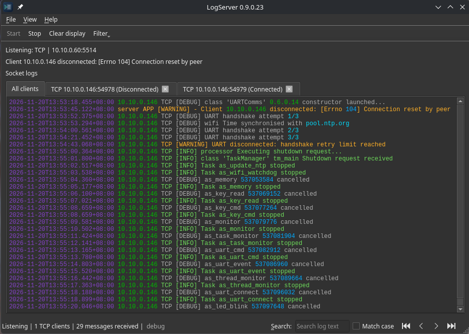

# LogServer 0.9.023 (Pre-Release)

Cross-platform Python/PySide6 desktop log receiver for IoT and other devices. Receives TCP and UDP messages in client tabs, displays colored text, and optionally writes every received severity to combined or per-client files. Open existing log files alongside live traffic, search and filter each pane independently, or merge two files by timestamp.



## Download and install from GitHub

Open [GitHub Releases](https://github.com/kpg141260/LogServer/releases), choose a release, and expand **Assets**. Choose an executable package to run the bundled application, or a **Source code** archive to run it with your own Python environment. Git is not required for either option.

| Release asset | Contents | Availability |
| --- | --- | --- |
| Source code (zip) | Python source code | Available |
| Source code (tar.gz) | Python source code | Available |
| `LogServer.tar.gz` | Linux executable package | Available |
| `LogServer.zip` | Linux executable package | Available |
| `LogServer-Windos.zip` | Windows executable package | Planned |
| `LogServer-macOS.tar.gz` | macOS executable package | Planned |
| `LogServer-macOS.zip` | macOS executable package | Planned |

The `.zip` extension alone does not identify a Windows package: `LogServer.zip` contains the Linux application. Windows and macOS executable packages will be added to Releases when available.

### Install the Linux executable package

1. Download either `LogServer.tar.gz` or `LogServer.zip` from the release assets.
2. Extract the complete archive into a permanent folder using your archive manager. Keep the executable and its accompanying files together, including the `_internal` folder. A separate Python or pip installation is unnecessary for the executable package.
3. Open a terminal in the extracted folder containing the `LogServer` executable and launch it with `./LogServer`. If extraction did not preserve executable permissions, run `chmod +x LogServer` first.

First launch opens setup as described below. Keep the extracted folder for subsequent launches. Executable-package installation has not been verified here.

### Install from source code

Install Python 3.11 or newer with pip and virtual-environment support. On Windows, the commands below use the Python launcher (`py`); on Linux and macOS, they use `python3`.

1. Download **Source code (zip)** or **Source code (tar.gz)** from the selected release. These contain source files, without a bundled executable or Python environment.
2. Extract the complete archive into a permanent folder. Use your archive manager; on Windows, ZIP files can be extracted with **Extract All...**.
3. Open a terminal in the extracted folder containing `log_server.py` and `requirements.txt`, then run the commands for your platform below. The folder name depends on the release tag.

#### Linux and macOS

```bash
python3 -m venv .venv
.venv/bin/python -m pip install -r requirements.txt
.venv/bin/python log_server.py
```

If creating the environment reports that pip or venv is unavailable, install your operating system's Python pip/venv support and retry.

#### Windows (PowerShell)

```powershell
py -3 -m venv .venv
.\.venv\Scripts\python.exe -m pip install -r requirements.txt
.\.venv\Scripts\python.exe log_server.py
```

These commands use the virtual environment directly, so activation is unnecessary. Internet access is required to download dependencies. Keep the extracted application folder; launch LogServer again using the final command for your platform. First launch opens setup as described below. Native Windows and macOS installation has not yet been verified.

## Run from source

Requires Python 3.11 or newer and PySide6 6.12.0. The existing virtual environment can run the application on this Linux checkout:

```bash
.venv/bin/python log_server.py
```

For a new environment, install [requirements.txt](requirements.txt) using `python -m pip install -r requirements.txt`, then run `python log_server.py`. On Windows, use the Python executable in your environment, for example `.venv\Scripts\python.exe log_server.py`. Native Windows and macOS execution has not yet been verified.

First launch opens setup before the main window. Choose the received-log folder and use **Socket and other preferences** to configure the listener. Configuration and state locations are shown in setup and are chosen through Qt's operating-system standard paths. Subsequent launches reuse saved preferences and, when enabled, window geometry. **File > Preferences...** controls appearance, fonts, display limits, startup behavior, listener settings and received-log files. The listener starts automatically by default; disable this in Preferences to start it manually. `python log_server.py --install` reopens setup without deleting logs.

The default listener is TCP on `127.0.0.1:5514`. To receive IPv4 devices on your network, set the bind address to `0.0.0.0` in Preferences and permit the selected port through your firewall. For IPv6, use an explicit address such as `::1` or `::`; IPv6 listeners accept IPv6 clients. Select TCP, UDP, or both on the configured port. Start/Stop controls the listener; socket and file changes apply at the next Start. Appearance, fonts, display limit, and keywords apply immediately.

This receiver uses plain sockets without authentication or encryption. Use it on trusted networks; keep it behind a firewall or a protected tunnel for remote devices. UDP delivery is best effort and has no acknowledgement.

## Linux desktop launcher

During startup setup, select **Create Applications menu launcher**, then **Save and Continue**. The option is unchecked by default and needs no administrator access. Open the Applications menu and search for **LogServer**.

To add or refresh the launcher later, reopen setup with `python log_server.py --install` from a source installation, or `./LogServer --install` from the executable package folder. Repeat this after moving the application or its Python environment.

## Device messages

TCP messages are newline-delimited bytes in the selected encoding, UTF-8 by default. A final unterminated line is received when the client disconnects or the idle timeout expires. UDP uses one datagram per message. Python's pickled `logging.handlers.SocketHandler` format and octet-counted syslog framing are not supported.

Accepted message content:

- Plain text, including common severity words such as `DEBUG`, `INFO`, `WARNING`, `ERROR`, and `CRITICAL`.
- Syslog text beginning with a priority such as `<11>`; severity is extracted from the priority.
- JSON objects with `message` or `msg`, and optional `level` or `severity`. Additional fields remain visible and are saved.

Examples of message content:

```text
INFO ^sensor-1^ temperature=24.5 C
ERROR ^pump-2^ motor failed
<11>Oct 28 10:00:00 pico sensor read failed
{"level":"warning","message":"temperature high","device":"pico","temperature":42.7}
```

A complete TCP sender using Python's standard library:

```python
import socket

with socket.create_connection(("127.0.0.1", 5514), timeout=5) as client:
    client.sendall(b"INFO ^sensor-1^ temperature=24.5 C\n")
```

The display colors severity, timestamps, IP addresses, paths, numeric values, comma-separated literal keywords configured in Preferences, and sections surrounded by `^`. Text and markers stay selectable. Incoming HTML is displayed literally; terminal escape sequences and control characters are removed. Invalid encoded bytes are replaced. Duplicate device timestamps and severity prefixes are removed from the live display when recognized; saved message content retains them. Display history is bounded independently of files, so clearing the display does not remove saved logs.

## Live views and pane controls

The **All clients** tab combines incoming messages. Separate client tabs identify the transport, IP address and source port; TCP tabs also show **Connected** or **Disconnected**. Disconnecting or stopping reception preserves displayed messages. Close an individual client tab with its close button; further messages from that client can recreate it. **All clients** stays open.

Use **View > Socket panel** and **View > File panel** to show or hide the panels. Hiding either panel preserves its contents and does not stop reception. Click a log pane or client tab to target its controls:

- **Clear display** in the toolbar clears that view without deleting saved files.
- **View > Line numbers** toggles line numbers for that view.
- Search and filters retain separate settings for each view, including both merge previews.

The status bar shows server state, connected TCP client count, received-message count and the colored application diagnostic level. This level controls internal diagnostics; it does not exclude received severities from the display or saved logs.

## Search and filters

Type literal text into **Search** in the status bar to highlight matches in the active pane. **Match case** makes the search case-sensitive. The adjacent buttons select the first, previous, next or last visible match; next and previous wrap around. The platform Find shortcut, usually **Ctrl+F** on Linux and Windows or **Command+F** on macOS, focuses Search. Large searches and highlighting update in the background.

The toolbar's **Filter** menu selects severity, IP address, protocol and device. Choose **All** within a category to clear that restriction. Categories combine, so a line must satisfy every active category. Device values are recognized from message metadata, including a leading `|device|` field after a LogServer record header.

Choose **Filter > Keyword...** for comma-separated literal keywords. A line passes when it contains any keyword, ignoring capitalization; this restriction combines with the other categories. An empty keyword field clears it. The number beside **Filter** counts active categories. **Reset filters** restores all lines in the active view.

Search, filters and line numbers affect the display only. Highlight keywords in Preferences add color emphasis; keyword filters hide nonmatching lines.

## Open and merge log files

Choose **File > Open log file...** to load an existing file into the file panel while socket reception continues. Files are read in the background as UTF-8, accepting a byte-order mark and replacing invalid bytes. The preview retains the last **Display line limit** lines from Preferences and reports omitted older lines. **File > Close log file** clears file previews and hides the panel without modifying source files.

To merge files:

1. Choose **File > Merge log files...** and select the first file, then the second in separate dialogs. Cancelling either selection leaves existing previews unchanged.
2. Review both previews. Click either to use its search, filters and line numbers.
3. Select **Merge...** beneath the previews and choose an output file. A successful merge opens the result in the file panel.

Merging reads both full source files, including lines omitted from the previews or hidden by filters. Records are sorted by timestamp, preserving continuation lines and duplicates. Equal timestamps retain source order. Timestamps must start a record and use `YYYY-MM-DD HH:MM:SS` or `YYYY-MM-DDTHH:MM:SS`, optionally enclosed in brackets, with optional fractional seconds and a timezone offset or `Z`. Timestamps without a timezone use the computer's local timezone. Content before the first timestamp and invalid timestamps are rejected.

The output cannot overwrite either source file, including aliases to those files. Output is saved atomically; a failed or cancelled merge preserves an existing destination. Sorting uses a temporary SQLite database in the system temporary folder. File and merge errors appear in the window.

## Received log files

Preferences selects **One combined file** or **One file per client IP**, the folder, combined file name, and rotation size/backup count. Existing files are appended. Rotation removes the oldest retained backup when the configured count is exceeded. Disabling rotation allows files to grow without a size limit.

Per-client file names use a stable hash of the socket IP address; every record includes the original IP, reception time with timezone, transport, and severity. Connections from the same IP share a file, including devices behind the same NAT. A device cannot supply a file path. File logging applies to every severity regardless of the application diagnostic level.

`application.log` in the standard application data folder records internal diagnostics separately. Bind failures, oversized messages, client limits, idle disconnections, and file errors are shown in the window. File-write failure stops the receiver and reports the error. TCP messages over the configured limit close that client; oversized UDP datagrams are rejected. A bounded display queue applies backpressure to reception; UDP may lose datagrams under load. Stop finishes data already read by the receiver and flushes buffered partial TCP lines; clients should finish sending before Stop.

## Command-line overrides

```bash
python log_server.py --help
python log_server.py --version
```

`--host`, `--port`, and `--protocol` override saved socket settings for the current run. Saving Preferences persists the settings shown in the dialog.

## Help

**Help > Help** opens the bundled [user guide](assets/help.md). **Help > About** shows application details and the version from the version manifest.

## Tests

Run the complete suite, including real loopback sockets, file persistence/rotation, first-launch setup, Preferences, client tabs, search and filters, file previews, timestamp merging, rich text, and Qt window lifecycle:

```bash
python -m unittest discover -s tests -v
```

Tests select Qt's offscreen platform by default and use temporary configuration, state, and log folders. They require permission to create TCP/UDP loopback sockets. Native appearance, firewall behavior, and device interoperability still require testing on the target operating systems.
